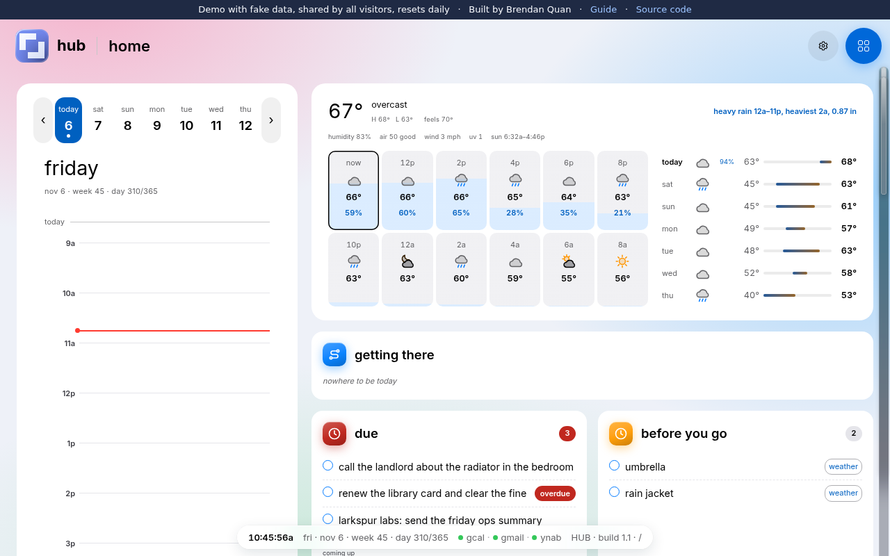
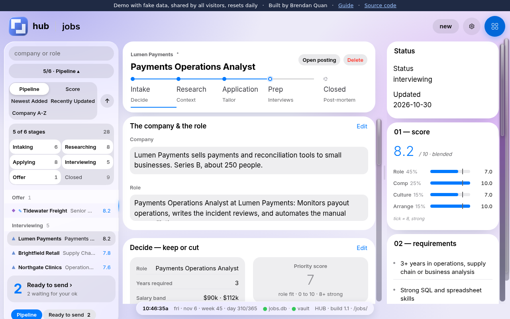
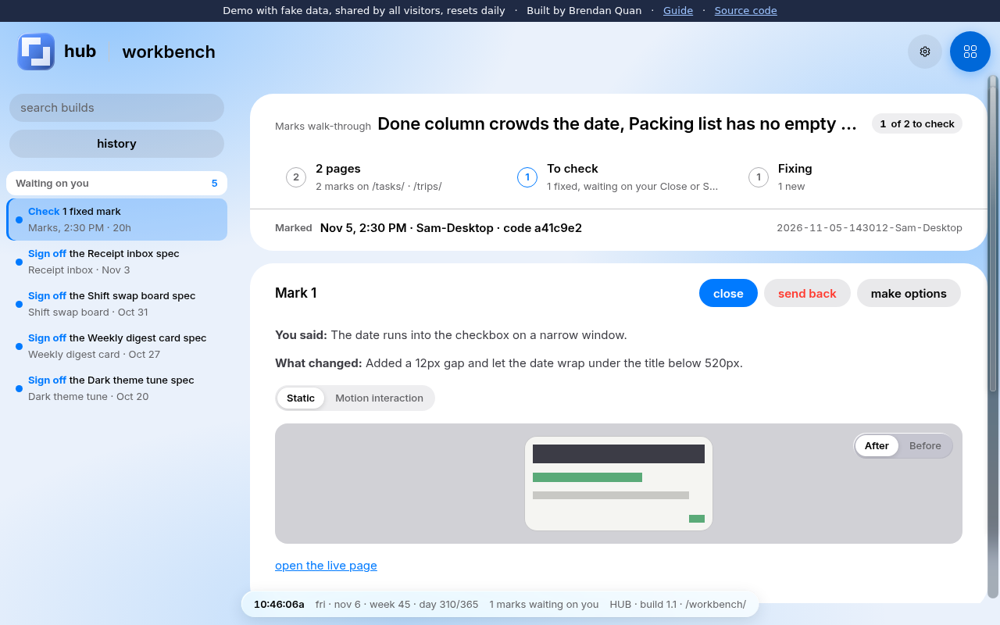
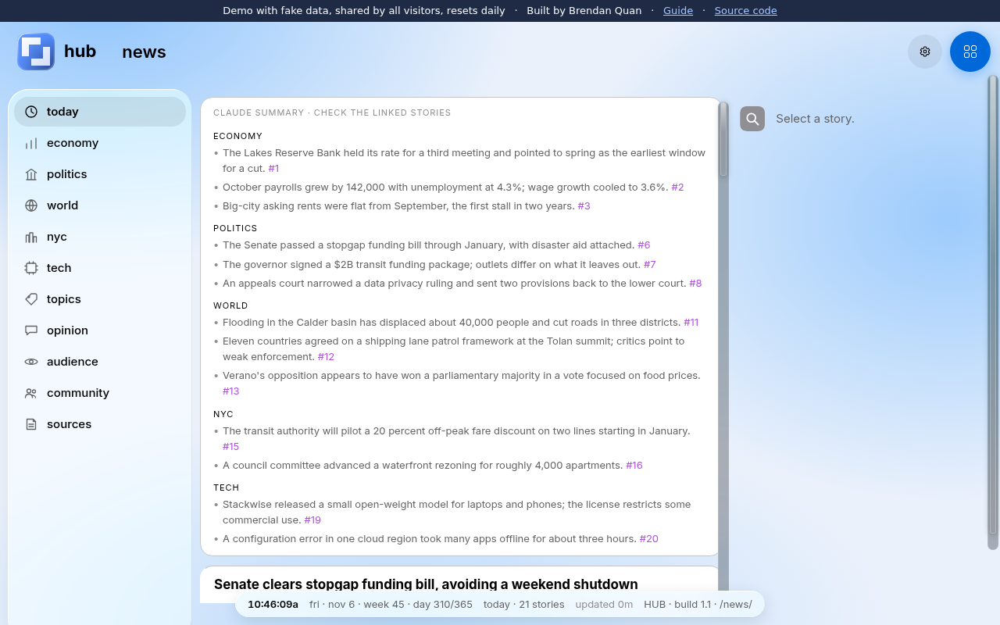

# Hub demo

**A personal dashboard that runs my day, built by directing Claude Code.** The Hub covers
job search, money, trips, mail, news, recipes, and the AI workflows behind them, across
19 pages. This copy runs the same code on a made-up person's data, so anyone can click through it.

Built by Brendan Quan.

## See it running

**[Open the live demo](https://hub-demo.onrender.com/guide/)**: one click, no sign-up, nothing to install.

> **If it is slow to open, keep the tab loading.** The demo runs on Render's free tier, which puts the
> server to sleep after 15 minutes with no visitors. The first request then waits 50 seconds or more
> while it wakes. Leave the page loading (refresh once if it comes up blank); after that every page is quick.

- It opens on the **Guide**, a ten-minute tour of the pages worth seeing.
- Click anything. Every visitor shares one copy of the data, and it resets each night.

| Home | Jobs |
|---|---|
|  |  |
| **Workbench** | **News** |
|  |  |

## Status and timeline

Many parts of the Hub are still being refined and completed, so some pages are rougher than others.

- **2026-11-06, first public version:** every page on fake data, with the Guide tour at `/guide`.
- **In progress, next update expected 2026-11-07:** the Guide as a frosted side panel on every page,
  a seeded week on the Home calendar, and fixes from a code review of both.

## What it covers

| Page | What it does | Where AI does the work |
|---|---|---|
| [Home](https://hub-demo.onrender.com/) | The day at a glance: schedule, tasks, cards, news. | A Claude-written morning briefing; the scheduler refreshes it at 06:00. |
| [News](https://hub-demo.onrender.com/news/) | Stories grouped across outlets, balanced left to right. | Sonnet writes the digest and cites every line to a story card. |
| [Checklists](https://hub-demo.onrender.com/checklists/) | Reusable lists: packing, prep, routines. | Claude drafts lists from a trip or a prep day. |
| [Automations](https://hub-demo.onrender.com/automations/) | Background lanes and what waits on a yes. | Headless Claude runs (claude -p) do the work; nothing ships without a click. |
| [Mail](https://hub-demo.onrender.com/mail/) | Inbox by sender: read, sort, summarize, draft. Never sends. | Claude summarizes threads and drafts replies for review. |
| [Finances](https://hub-demo.onrender.com/finances/) | Earnings, the transaction book, stocks, who owes what. | Transactions categorized from payee history and email receipts. |
| [Purchases](https://hub-demo.onrender.com/purchases/) | Buy-or-skip research, seven stages to a verdict. | A research skill fills each stage with sourced findings. |
| [Trips](https://hub-demo.onrender.com/trips/) | Trip planner: flights, housing, day-by-day plans. | Fare and stay research skills price options; friends' adds get researched. |
| [Food](https://hub-demo.onrender.com/food/) | Restaurants worth it, with the evidence per score. | Claude scores each place with the sources behind it. |
| [Recipes](https://hub-demo.onrender.com/recipes/) | A family recipe library: scale it, shop it, cook it. | Transcribed from photographed cards. |
| [Work](https://hub-demo.onrender.com/work/) | Shift dashboards: batch prep and bar back. | Prep quantities computed from par levels. |
| [Jobs](https://hub-demo.onrender.com/jobs/) | Application pipeline: intake, research, interview prep. | A daily sweep scores postings and drafts tailored materials. |
| [Workbench](https://hub-demo.onrender.com/workbench/) | Specs, plans and design picks to approve or send back. | Every Claude build stops here for sign-off. This demo was built that way. |
| [Blueprints](https://hub-demo.onrender.com/blueprints/) | The shared UI parts, read live off the CSS. | Claude reads these before building any screen. |
| [Capabilities](https://hub-demo.onrender.com/capabilities/) | Every skill on the machine and what it does. | The skills are the AI workflows themselves. |
| [Inventory](https://hub-demo.onrender.com/inventory/) | Every program on each computer, and how to restore it. | Scanners plus a Claude-kept list of hand-built tools. |
| [Artifacts](https://hub-demo.onrender.com/artifacts/) | Published pages, grouped by category. | Pages Claude wrote and published. |
| [Viewer](https://hub-demo.onrender.com/viewer/) | What Claude shows, full size, and a drop box back. | Claude's screenshots and files land here. |
| [Vault Map](https://hub-demo.onrender.com/vault-map/) | Every file in the notes vault, classified. | Claude classified and described each file. |

## How it was built

- **I direct, Claude Code builds.** Each feature starts as a written spec and plan. Claude writes the
  code, and the result stops on the Workbench page until I approve it or send it back.
- **AI runs the daily work too.** Scheduled headless Claude runs write the morning briefing and the
  news digest and sweep new job postings. In this demo those outside calls are
  switched off and answer with a short note.
- **This public copy went through the same loop:** a spec and plan, three rounds of automated code
  review, a scanner that refuses to publish if any real name, email, path or key turns up, and a
  headless-browser run through every page.

## Under the hood

- **Python and Flask**, one blueprint per page under `dashboard/hub/<module>/`.
- **One SQLite database per module**, built from the migrations in `db/migrations/<module>/`.
- **React pages with no build step**: each `.jsx` file is transpiled once by `node` with a vendored
  Babel (`dashboard/hub/jsx_build.py`) and cached.
- **Fake data**: `seed/` writes the persona's month into `demo-vault/pristine/`. Every date in it is
  stored as an offset (`@d-3`), so the month always ends today.

## What is switched off

The real Hub calls Claude, Google Calendar and Gmail, a bank feed and a few public APIs. Here those
routes answer with a short note instead, and the process cannot open an outside connection at all.
`DEMO-SECURITY.md` explains the guard and lists every switched-off route.

Visitors share one copy of the data and can add, edit and tick things. It all resets at 00:00 UTC.

## Run it yourself

Needs Python 3.14 and `node` on the PATH.

```bash
python3 -m venv .venv && .venv/bin/pip install -r requirements.lock
cd dashboard/hub
DEMO_MODE=1 VAULT_PATH="$PWD/../../demo-vault" ../../.venv/bin/gunicorn -w 1 --threads 8 -b 127.0.0.1:5099 app:app
```

Then open http://127.0.0.1:5099/guide/. Or build the `Dockerfile`, which runs the same command.

Tests for the demo layer: `DEMO_MODE=1 VAULT_PATH="$PWD/demo-vault" python3 -m pytest tests/demo -q`. The seeder tests run without the demo layer: `python3 -m pytest tests/demo/test_seed.py -q`.
from the repo root.

## How this copy was made

An export script in the private repo copies the tracked code, swaps personal names for fake ones,
adds the demo layer, the Guide and the seeders, builds every database and seeds it, then scans
the result for names, emails, paths and keys and refuses to write it if anything turns up.
